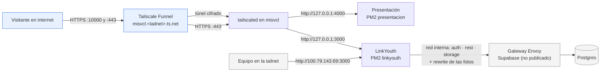
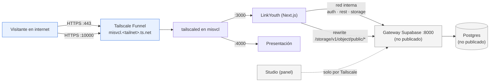

# Publicación en internet y auditoría de seguridad

Qué se publicó de LinkYouth en internet, cómo, qué riesgos encontró la
auditoría del 2026-10-06 y qué se hizo o se va a hacer con cada uno.

> **Actualización del 2026-10-06 (tarde).** Cambio de plan: la demo del jueves
> 8/10 también tiene que poder abrirse por la dirección pública. Se corrigió
> H1 (y H6, H7, H13 y parte de H8) en el PR #11, se desplegó `main` y la app
> quedó publicada en `https://misvcl.<tailnet>.ts.net/`. Ver §1, §5 y §6.

Este documento **no contiene contraseñas, claves ni tokens**. El nombre de la
tailnet se reemplaza por `<tailnet>`: la dirección real del servidor es
`misvcl.<tailnet>.ts.net`.

---

## 1. Resumen

| | Estado |
|---|---|
| Presentación (puerto 4000) | **Publicada** en `https://misvcl.<tailnet>.ts.net:10000/`. La diapositiva de demo (enlace y QR) abre la app publicada |
| App LinkYouth (puerto 3000) | **Publicada** en `https://misvcl.<tailnet>.ts.net/` (443), desde `main` (PR #11), con H1 corregido |
| Supabase (puerto 8000) | **No se publica nunca.** Las fotos las sirve la app con un `rewrite` (§6.1, hecho) |
| Demo del jueves 8/10 | Por la dirección pública. Si Funnel o la conexión fallan, sigue funcionando por Tailscale (`http://100.79.143.69:3000`): la app no depende de Funnel |

Lo que se cambió en la app, la base y el bucket está en §5. Las contraseñas y
los contenedores de Supabase siguen intactos hasta después de la presentación
(H3, H9, H11 y H4 quedan para después, §6).

---

## 2. Por qué Tailscale Funnel

El servidor `misvcl` está en una red doméstica, detrás del router, y ya está
en una tailnet (IP `100.79.143.69`). Funnel publica un puerto local en
internet a través de la infraestructura de Tailscale:

- **Sin abrir puertos en el router** ni exponer la IP de la casa.
- **HTTPS automático** con un certificado válido para `*.ts.net`, sin
  gestionar Let's Encrypt.
- **Gratis**, con un dominio `*.ts.net` incluido.
- **Se apaga con un comando** (`tailscale funnel reset`).

Límites que hay que tener presentes:

- **Solo tres puertos públicos: 443, 8443 y 10000.** Por eso cada servicio
  publicado ocupa uno, y Supabase no debería ocupar ninguno (§6.1).
- **El dominio es `misvcl.<tailnet>.ts.net`**: no se puede usar un dominio
  propio, y el nombre de la tailnet queda a la vista de quien visite el sitio.
- El tráfico pasa por los relés de Tailscale: más latencia que un servidor
  directo, y un ancho de banda pensado para proyectos chicos.
- Si el servidor, Tailscale o la conexión de la casa se caen, el sitio se cae.

---

## 3. Lo publicado

| Público | Local | Servicio | Desde |
|---|---|---|---|
| `https://misvcl.<tailnet>.ts.net:10000/` | `http://127.0.0.1:4000` | Presentación (PM2 `presentacion`, Next.js, 20 diapositivas) | 2026-10-06 |
| `https://misvcl.<tailnet>.ts.net/` | `http://127.0.0.1:3000` | App LinkYouth (PM2 `linkyouth`, `main`) | 2026-10-06 |

Comandos usados:

```bash
tailscale funnel --bg --https=10000 4000
tailscale funnel --bg 3000          # puerto público 443
```

`--bg` deja la configuración guardada en Tailscale: sobrevive a reinicios del
servidor sin ningún servicio extra. Para habilitarlo se activaron en la
tailnet **HTTPS Certificates** y el atributo `funnel` del nodo, y se ejecutó
`sudo tailscale set --operator=claw` para que el usuario del servidor pueda
manejar Funnel sin `sudo`.

El puerto 8443 queda libre. Se usó un rato, el 2026-10-06, para probar la app
desde la dirección pública antes del merge, y se apagó.

### Arquitectura actual



---

## 4. Auditoría de seguridad (2026-10-06)

Se hizo en modo de solo lectura: no se cambió nada para auditar.

### 4.1 Lo que está bien

- **Ningún secreto de Supabase es el de ejemplo.** `JWT_SECRET`, `ANON_KEY`,
  `SERVICE_ROLE_KEY`, `POSTGRES_PASSWORD` y `DASHBOARD_PASSWORD` difieren de
  `.env.example` y de los valores publicados en la documentación de Supabase.
  Las claves JWT se emitieron con `iss: supabase` (las de demo dicen
  `supabase-demo`). No hace falta regenerar las claves JWT.
- **RLS activado en las 18 tablas de `public`**, todas con políticas.
  `db/verificar-raspado-anonimo.sh` pasa: los datos de personas están cerrados
  a `anon` y lo público está abierto a propósito.
- **La `service_role` nunca llega al navegador.** El código de la app no la
  usa (solo `scripts/crear-usuarios-prueba.mjs`, a mano). No aparece en
  `.next/static`, en `.next/server` ni en el HTML servido.
- **La app solo habla con Supabase desde el servidor.** No hay cliente de
  Supabase en el navegador, ni realtime, ni redirecciones de auth. El navegador
  solo pide a Supabase las imágenes públicas (`/storage/v1/object/public/…`).
- **El gateway (puerto 8000) protege lo administrativo:** Studio (`/`) pide
  usuario y clave; `/pg/*` (administración de la base) exige `service_role`;
  `/mcp`, `/api/mcp` y `/realtime/v1/api/tenants` están bloqueados.

Rutas que expone el gateway y qué piden:

| Ruta | Servicio | Sin clave | Con clave `anon` |
|---|---|---|---|
| `/` y resto | Studio (panel) | 401 (usuario y clave del panel) | 401 |
| `/auth/v1/*` | GoTrue | 401 | 200 |
| `/rest/v1/*` | PostgREST | 401 | según RLS |
| `/graphql/v1` | pg_graphql | 401 | 404 |
| `/storage/v1/*` | Storage | 400 | 200 (bucket `avatars` público) |
| `/realtime/v1/*` | Realtime | 403 en `api/tenants` | 403 en `api/tenants` |
| `/functions/v1/*` | Edge Functions | sin respuesta | 401 |
| `/pg/*` | postgres-meta | 401 | 403 (exige `service_role`) |
| `/mcp`, `/api/mcp` | Studio MCP | 403 | 403 |

### 4.2 Hallazgos, de mayor a menor gravedad

| # | Gravedad | Hallazgo | Estado |
|---|---|---|---|
| H1 | **Alta** | **Cualquier usuario con sesión lee los datos de todos los jóvenes.** `perfil_tags`, `perfil_habilidades`, `formaciones` y `resenias` tienen `select … to authenticated using (true)`. Como el registro está abierto y se autoconfirma, "tener sesión" equivale a "cualquiera". Si se publicara la API, se podría descargar todo con un script. | **Corregido** el 2026-10-06 (migración 003, PR #11, §6.3) |
| H2 | **Alta** (si se publicara Supabase) | **Publicar `/auth/v1` y `/rest/v1` abre la API a internet** y hace que la app dependa de Funnel para cada consulta: si Funnel o la conexión fallan, también se cae la demo por Tailscale. | Resuelto por diseño: Supabase no se publica (§6.1) |
| H3 | **Alta** (operativo) | **Cambiar `POSTGRES_PASSWORD` en `.env` no cambia la contraseña de la base**, que ya está inicializada: hay que cambiarla en cada rol interno. Si queda desalineada, se caen auth, storage, rest o el pooler. | Pendiente (§6.2) |
| H4 | Media | **Postgres, el pooler y el gateway escuchan en todas las interfaces** (`0.0.0.0:5432`, `6543` y `8000`): son accesibles desde la red local (Wi-Fi de la casa). Docker publica sus puertos por fuera de ufw. No llegan a internet salvo que el router los redirija. | Pendiente (§6.5) |
| H5 | Media | **Todos los inicios de sesión comparten un mismo límite de intentos.** Como las llamadas de auth salen del servidor de Next, GoTrue probablemente ve una sola IP, y no hay límites configurados (`RATE_LIMIT_*`). Un ataque de fuerza bruta agotaría el límite de todos, y la app no limita intentos por su cuenta. | Pendiente (§6.5) |
| H6 | Media | **La vista `perfiles_publicos`** (nombre, apellido, país, bio y foto de los jóvenes con cuenta activa) se lee sin sesión. Es a propósito, para el registro, pero a través de una API pública se descargaría entera. | **Corregido** el 2026-10-06: la vista expone solo `id` y `nombre_usuario` (migración 003) |
| H7 | Media | **El bucket `avatars` acepta cualquier archivo**: es público, sin límite de tamaño ni de tipo. Un usuario con sesión puede subir HTML o archivos grandes a su carpeta. | **Corregido** el 2026-10-06: 2 MB y JPG/PNG/WebP (migración 004) |
| H8 | Baja | **Faltan cabeceras.** La app manda `X-Frame-Options`, `nosniff` y `Referrer-Policy`, pero no `Strict-Transport-Security`, `Content-Security-Policy`, `Permissions-Policy` ni `noindex`, y anuncia `X-Powered-By: Next.js`. La presentación no manda ninguna cabecera de seguridad. | **Corregido en parte** el 2026-10-06 (PR #11): HSTS, `Permissions-Policy`, `noindex` y sin `X-Powered-By`. Faltan la CSP y las cabeceras de la presentación (§6.4) |
| H9 | Baja | **Registro por teléfono activado y autoconfirmado** (`ENABLE_PHONE_SIGNUP`, `ENABLE_PHONE_AUTOCONFIRM`), aunque la app no lo usa. | Pendiente (§6.5) |
| H10 | Baja | **Los archivos de secretos los podían leer otros usuarios del servidor** (`~/supabase-project/.env` y `~/LinkYouth/.env.local`, permisos 664). | **Corregido** el 2026-10-06: permisos 600 |
| H11 | Baja | **El usuario del panel de Studio es el de ejemplo** (`supabase`). | Pendiente (§6.5) |
| H13 | **Crítica** | **Sin sesión se podían modificar perfiles a través de la vista `perfiles_publicos`.** La vista es actualizable, su dueño (`postgres`) saltea RLS y los privilegios por defecto de Supabase le daban `INSERT`, `UPDATE` y `DELETE` a `anon`. Se encontró al revisar H1: con el rol `anon`, 9 perfiles modificables (prueba dentro de una transacción deshecha). No llegó a internet porque Supabase no se publica, pero el puerto 8000 está abierto en la red local (H4). | **Corregido** el 2026-10-06 (migración 003): `revoke all` y `grant select`. `db/verificar-raspado-anonimo.sh` ahora lo prueba |
| H12 | Baja | **Se puede consultar si una cuenta está activa sin sesión.** La función `cuenta_activa(uuid)` es `SECURITY DEFINER`, se puede llamar como RPC con `anon` y responde un booleano. | Mitigado si Supabase no se publica |

Las demás tablas con `using (true)` son catálogos o datos que se muestran sin
sesión a propósito y **no contienen datos personales**: `tags`, `habilidades`,
`vacante_tags_publicos`, `vacante_habilidades` y `evento_tags`. Se dejan
como están.

---

## 5. Lo hecho antes del jueves 8/10

1. **Permisos 600** en `~/supabase-project/.env` y `~/LinkYouth/.env.local`
   (H10). Docker Compose y PM2 corren como el mismo usuario y los siguen
   leyendo.
2. **Presentación publicada** en `https://misvcl.<tailnet>.ts.net:10000/`.
3. **H1, H6 y H13 corregidos** con la migración
   `db/migraciones/003-h1-datos-de-jovenes.sql`, aplicada el 2026-10-06:
   - Cada joven ve sus `perfil_tags`, `perfil_habilidades` y `formaciones`; una
     empresa, los de quienes tienen una postulación no cancelada a sus
     vacantes. `resenias`: quien la escribió y la empresa reseñada.
   - `perfiles_publicos` queda en `id` y `nombre_usuario`, de solo lectura.
   - `formaciones_publicas` (institución y título, sin `perfil_id`) para la
     ficha de institución.
   - Probado con `db/verificar-raspado-anonimo.sh` y con un joven y una
     empresa de prueba: un usuario no lee los datos de otro, y la empresa deja
     de ver al postulante cuando cancela. Los usuarios de prueba se borraron.
4. **H7 corregido** con la migración `004-limites-bucket-avatars.sql`: 2 MB y
   JPG/PNG/WebP. Probado: un HTML y una imagen de más de 2 MB se rechazan.
5. **App lista para publicarse** (PR #11, mergeado): `rewrite` de las fotos y
   rutas relativas (§6.1), cabeceras y `noindex` (§6.4, sin la CSP).
6. **Despliegue:** `main` compilado y reiniciado en `:3000`, y
   `tailscale funnel --bg 3000`.
7. **Pruebas de punta a punta** (Playwright) por Tailscale y por la dirección
   pública: portada, registro y login de postulante y de empresa, paneles,
   perfil, ficha de institución, fotos y vuelta a la portada. Desde internet,
   los puertos 8000 y 5432 no responden.
8. **Presentación:** el enlace y el QR de la diapositiva de demo abren
   `https://misvcl.<tailnet>.ts.net/` (QR verificado decodificándolo).

Respaldos en el servidor (permisos restringidos):

- `~/respaldos/2026-10-06-publicacion/`: configuración de Funnel y permisos
  anteriores a la publicación de la presentación.
- `~/respaldos/2026-10-06-h1/`: políticas RLS y esquema anteriores a la
  migración 003, y configuración anterior del bucket.
- `~/respaldos/2026-10-06-despliegue/`: el build anterior de la app (`.next`),
  la rama y el commit que corrían, y la configuración de Funnel antes del 443.

---

## 6. Plan: lo hecho y lo que queda para después del jueves

Orden sugerido: §6.3 (H1) es el que bloquea la publicación de la app.

### 6.1 Supabase sin publicar; la app sirve las fotos

> **Hecho** el 2026-10-06 (PR #11). Las 2 URLs absolutas guardadas no se
> reescribieron: se corrigen al mostrarlas.

La app ya habla con Supabase solo desde el servidor, así que Supabase no
necesita estar en internet. Lo único que el navegador le pide son las fotos
públicas. Se resuelve con un `rewrite` de Next.js en la propia app:

```ts
// next.config.ts
async rewrites() {
  return [{
    source: "/storage/v1/object/public/:path*",
    destination: "http://127.0.0.1:8000/storage/v1/object/public/:path*",
  }];
}
```

- **Las URLs de las fotos se muestran como rutas relativas**
  (`/storage/v1/object/public/avatars/…`). Hoy hay 2 guardadas con
  `http://100.79.143.69:8000/…` y el código de subida
  (`src/lib/supabase/almacenamiento.ts`) las genera absolutas. Se corrige al
  mostrarlas (quitando el origen) y al guardar las nuevas.
- **`NEXT_PUBLIC_SUPABASE_URL` no cambia:** la app sigue hablando con Supabase
  por la red interna y no depende de Funnel.
- **No hay que tocar** `API_EXTERNAL_URL`, `SUPABASE_PUBLIC_URL` ni las URL de
  redirección de auth, porque el registro se autoconfirma y no se mandan
  enlaces por correo. Si un día se activa la confirmación por correo, habrá que
  apuntar `SITE_URL` a la dirección pública de la app.
- **Ventaja de seguridad:** el puerto 8443 queda libre y la API, Studio y la
  base no se exponen. Se resuelven H2, H6 (en lo que hace a la API) y H12.

### 6.2 Rotar `POSTGRES_PASSWORD` (H3)

En una ventana sin uso, con la app avisada:

1. **Respaldo:** `docker exec supabase-db pg_dumpall -U postgres > respaldo-AAAA-MM-DD.sql`
   (fuera del repo, permisos 600) y copia de `~/supabase-project/.env` con
   fecha.
2. Generar una contraseña nueva (`openssl rand -hex 24`) y guardarla en el
   gestor de contraseñas del equipo.
3. **Cambiarla en la base, en cada rol con login que usa los servicios**, en
   una sola transacción, con `ALTER ROLE … WITH PASSWORD '…'`. Los roles son
   `postgres`, `supabase_admin`, `authenticator`, `pgbouncer`,
   `supabase_auth_admin`, `supabase_storage_admin`,
   `supabase_functions_admin`, `supabase_replication_admin`,
   `supabase_read_only_user` y `supabase_etl_admin`. Conviene ejecutarlo desde
   un archivo con permisos 600 y no desde la línea de comandos, para que la
   contraseña no quede en el historial.
4. Actualizar `POSTGRES_PASSWORD` en `~/supabase-project/.env`.
5. Recrear los contenedores que la usan, **sin `down` ni `-v`**:
   `docker compose up -d --force-recreate`.
6. **Verificar:** `docker compose ps` (todos `healthy`), login en la app,
   `bash db/verificar-raspado-anonimo.sh`, subir una foto y abrir Studio.
7. **Volver atrás si algo falla:** restaurar el `.env` respaldado, repetir el
   paso 3 con la contraseña anterior y repetir el paso 5.

### 6.3 Corregir H1: políticas de lectura de datos de jóvenes

> **Hecho** el 2026-10-06 (migración 003, PR #11; ver §5). Queda como mejora
> reemplazar `perfiles_publicos` por una función `nombre_usuario_ocupado()`,
> que no expone ni ids ni nombres de usuario, y sumar los casos a
> `db/verificar-politicas.sh`. Lo que decide cada pantalla futura (por
> ejemplo, la lista de postulantes) se abre cuando exista. Ver
> `docs/decisiones.md`.

En una rama con PR hacia `main`. Hoy:

```sql
-- perfil_tags, perfil_habilidades, formaciones, resenias
create policy …_lectura_publica on … for select to authenticated using (true);
```

Propuesta, a validar con el equipo según lo que cada pantalla necesita ver:
el dueño ve lo suyo, y **una empresa ve los datos de quienes se postularon a
sus vacantes**.

```sql
using (
  perfil_id = auth.uid()
  or exists (
    select 1 from postulaciones p
    join vacantes v on v.id = p.vacante_id
    where p.perfil_id = <tabla>.perfil_id
      and v.empresa_id = auth.uid()
  )
)
```

- Revisar `resenias`: quién las tiene que ver (¿la empresa reseñada, todos con
  sesión?) y restringir en consecuencia.
- Revisar si `perfiles_publicos` (H6) necesita `bio` y `foto_url` para el
  registro, o si alcanza con `nombre_usuario`.
- **Probarlo** con los usuarios de prueba (`docs/usuarios-prueba.md`): un
  postulante no ve datos de otro postulante; una empresa ve los de sus
  postulantes y no los de los demás. Agregar esos casos a
  `db/verificar-politicas.sh`.

### 6.4 Cabeceras y `noindex` (H8)

> **Hecho en parte** el 2026-10-06 (PR #11). Falta: la CSP (primero como
> `Report-Only`) y las cabeceras y el `noindex` de la presentación.

En la misma rama o en otra, con PR hacia `main`, en `next.config.ts`:

- `Strict-Transport-Security: max-age=31536000` (Funnel ya sirve HTTPS).
- `Permissions-Policy: camera=(), microphone=(), geolocation=()`.
- `X-Robots-Tag: noindex, nofollow` y un `robots.txt` con `Disallow: /`.
- `poweredByHeader: false`.
- CSP primero como `Content-Security-Policy-Report-Only` y después aplicada,
  como ya anticipa el comentario de `next.config.ts`.

La presentación (otro proyecto) también debería llevar `noindex`.

### 6.5 Resto de pendientes

| Hallazgo | Acción |
|---|---|
| H11 + panel | Rotar `DASHBOARD_PASSWORD` y cambiar `DASHBOARD_USERNAME` en `~/supabase-project/.env`; recrear solo el gateway (`docker compose up -d api-gw`). |
| H9 | `ENABLE_PHONE_SIGNUP=false` y `ENABLE_PHONE_AUTOCONFIRM=false`; recrear `auth`. |
| H7 | **Hecho** el 2026-10-06 (migración 004). |
| H5 | Confirmar qué IP ve GoTrue. Limitar intentos de inicio de sesión y registro en la app (por IP del visitante, que Funnel manda en `X-Forwarded-For`) y ajustar los `GOTRUE_RATE_LIMIT_*`. |
| H8 | CSP aplicada (después del modo Report-Only). |
| H4 | Que 5432, 6543 y 8000 escuchen solo en la IP de Tailscale o en `127.0.0.1`, o filtrarlos en la cadena `DOCKER-USER` de iptables (requiere sudo). Cuidado: si el puerto queda atado a la IP de Tailscale y Tailscale no arrancó todavía, el contenedor no levanta. Verificar además que el router no redirija puertos a `192.168.1.8`. |

### 6.6 Publicar la app

> **Hecho** el 2026-10-06, antes de lo previsto. Ver §5.

Solo con H1 corregido, y con los cambios de §6.1, §6.3 y §6.4 mergeados en
`main` y probados:

1. Compilar desde `main` (`npm run build`) y ejecutar `pm2 restart linkyouth`.
2. Ejecutar `tailscale funnel --bg --https=443 3000`.
3. **Probar de punta a punta desde la dirección pública:** portada, registro
   de un usuario de prueba, inicio de sesión como postulante y como empresa,
   paneles, fotos y vuelta a la portada. Borrar el usuario de prueba al
   terminar.
4. Comprobar que siga funcionando por Tailscale (`http://100.79.143.69:3000`).

### Arquitectura objetivo



---

## 7. Mantenimiento, apagado y vuelta atrás

**Ver qué está publicado:**

```bash
tailscale funnel status
```

**Apagar una sola publicación:**

```bash
tailscale funnel --https=443 off      # la app
tailscale funnel --https=10000 off    # la presentación
```

**Apagar todo lo publicado:**

```bash
tailscale funnel reset
```

Los servicios siguen funcionando por Tailscale; solo dejan de verse desde
internet.

**Volver atrás lo del 2026-10-06 (tarde):**

1. **App en internet:** `tailscale funnel --https=443 off`. Sigue andando
   por Tailscale.
2. **Código:** `git revert -m 1 <merge del PR #11>` en `main`, `npm run build`
   y `pm2 restart linkyouth`. Si hay apuro, restaurar el build anterior desde
   `~/respaldos/2026-10-06-despliegue/next-antes.tar.gz` y reiniciar.
3. **Políticas:** las definiciones anteriores están en
   `~/respaldos/2026-10-06-h1/politicas-antes.sql`. No se recomienda volver:
   reabre H1 y H13.
4. **Bucket:** el `update` inverso está en el encabezado de la migración 004.
5. **Presentación:** `git revert` del último commit en `~/presentacion`,
   compilar con `pnpm exec next build --webpack` y `pm2 restart presentacion`.

**Volver al estado anterior a la publicación de la presentación:**

1. Ejecutar `tailscale funnel reset`. La configuración previa estaba vacía; hay copia en
   `~/respaldos/2026-10-06-publicacion/tailscale-serve-antes.json`.
2. Los permisos anteriores de los `.env` (664) están anotados en
   `~/respaldos/2026-10-06-publicacion/permisos-antes.txt`. No se recomienda
   volver a ellos.

**Mantenimiento:**

- La presentación, LinkYouth y Supabase están **siempre encendidos**: el
  conmutador de aplicaciones del servidor (`app`) no los detiene. Ver
  `~/SERVIDOR.md` en el servidor.
- Funnel guarda su configuración en Tailscale y la reaplica al reiniciar.
- Si cambia el puerto local de un servicio, hay que volver a ejecutar el
  `tailscale funnel` correspondiente.
- Cada cambio en la configuración de Supabase o de la app se hace con un
  respaldo con fecha previo.
