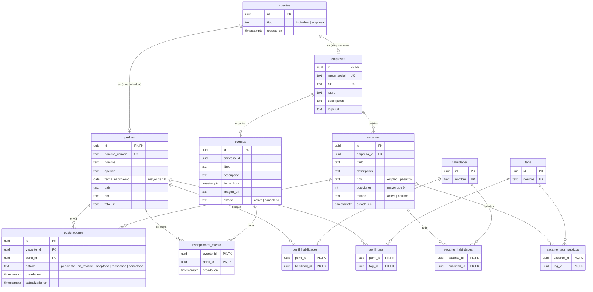

# Base de datos básica de LinkYouth

Diagrama entidad-relación de las tablas principales del proyecto. El SQL que
crea estas tablas está en [`esquema.sql`](./esquema.sql); es una versión
simplificada de `db/schema.sql`, sin datos de prueba, sin políticas de
seguridad y sin funciones.

## Diagrama

**Cómo leerlo:** `PK` es la clave primaria (identifica cada fila), `FK` es una
clave foránea (apunta a una fila de otra tabla) y `UK` es un valor único (no
se puede repetir). `||--o{` se lee «uno a muchos»: por ejemplo, una empresa
publica muchas vacantes, y cada vacante es de una sola empresa.

## Para qué sirve cada tabla

**cuentas** — Es la puerta de entrada: toda persona u organización que usa
LinkYouth tiene una cuenta. El campo `tipo` dice si es una cuenta individual
(alguien que busca trabajo) o de empresa, y eso decide qué ve cada una.

**perfiles** — Los datos de la persona joven: nombre, usuario, país, una
biografía corta y su foto. Comparte el `id` con su cuenta. Tiene una regla en
la base: la fecha de nacimiento tiene que ser de alguien mayor de 18 años, así
que no se puede saltear desde la pantalla.

**empresas** — Los datos de la organización: razón social, rubro, descripción
y logo. También comparte el `id` con su cuenta. La razón social y el RUT son
únicos: no puede haber dos empresas registradas con el mismo RUT.

**tags** — El catálogo de intereses («Desarrollo web», «Datos», «Atención al
cliente»…). Es una lista cerrada que carga el equipo, para que todos elijan
de las mismas opciones y dos perfiles se puedan comparar.

**habilidades** — El catálogo de conocimientos («HTML y CSS», «SQL», «Trabajo
en equipo»…). Está separado de los intereses porque no es lo mismo «me
interesa» que «sé hacerlo».

**perfil_tags** y **perfil_habilidades** — Unen cada perfil con los intereses
y las habilidades que eligió. Son tablas de relación «muchos a muchos»: un
perfil tiene muchas habilidades, y una habilidad la tienen muchos perfiles.
Esto reemplaza al currículum: tu ficha es lo que sabés hacer.

**vacantes** — Cada búsqueda que publica una empresa: título, descripción, si
es empleo o pasantía, cuántos puestos hay y si sigue activa o ya se cerró.

**vacante_habilidades** y **vacante_tags_publicos** — Qué habilidades pide y
a qué intereses apunta cada vacante. Al cruzarlas con las del perfil se puede
mostrar, requisito por requisito, cuánto coincide una persona con la búsqueda.

**postulaciones** — Registra que una persona se postuló a una vacante y en qué
etapa está: pendiente, en revisión, aceptada, rechazada o cancelada. La base
impide que alguien se postule dos veces a la misma vacante.

**eventos** — Talleres y charlas que organizan las empresas e instituciones,
con fecha, descripción e imagen. Se pueden cancelar, pero no se borran.

**inscripciones_evento** — Quién se anotó a cada evento. La clave está
formada por el evento y el perfil juntos, así nadie se anota dos veces.
